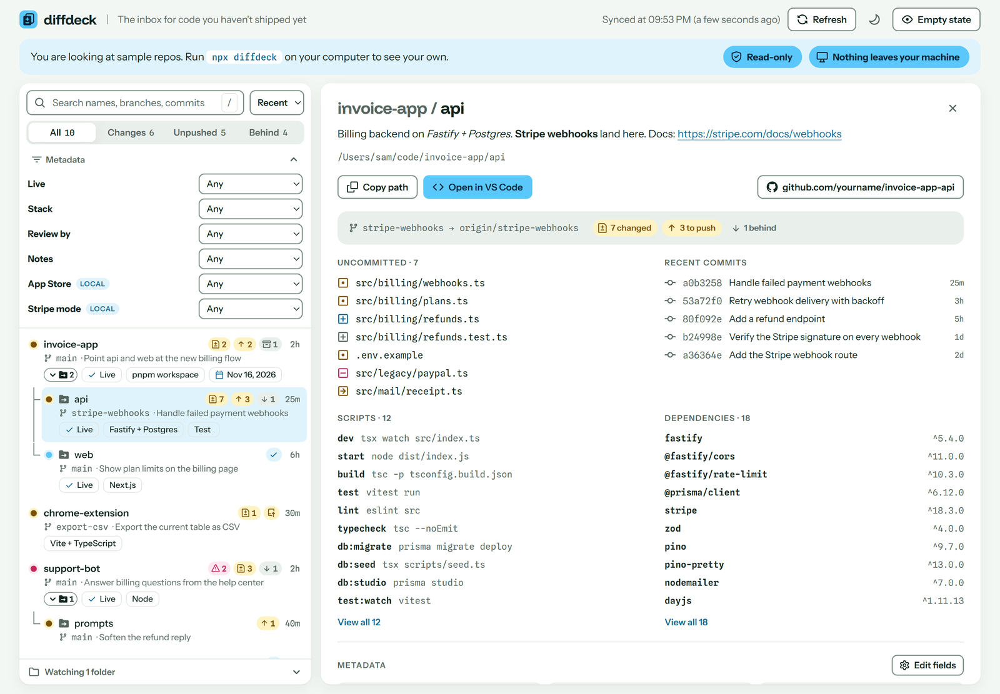

# diffdeck

**The inbox for code you haven't shipped yet.**

Every local git repo you juggle, on one page: branch, uncommitted changes, unpushed commits, nested repos and your own metadata. Read-only: it never commits, fetches or writes to a repo.



See it with sample repos: [live demo](https://thinkdj.github.io/diffdeck/)

```sh
npx diffdeck
```

That starts diffdeck on your machine at http://localhost:4747 and opens it. Run it again while it is open and it just brings the page back up. Options: `--port <n>`, `--no-open`.

The page is laid out like an inbox: the list of repos on the left, the one you picked on the right, with its description, uncommitted files, recent commits, package.json scripts and dependencies, and metadata. Click under a repo's name to give it a description: `*bold*`, `_italic_` and links work, and Enter saves. Move with the arrow keys, press `/` to search names, branches, commits and file paths (matches are highlighted), and filter by status or by your own metadata fields. Open **Watching** under the list to add a repo path or a folder that holds repos, or click Browse. Each path is checked one level down, and any repo found is checked one level down for nested repos, which sit indented under their parent in the list. Your list is stored in `~/.diffdeck.json`.

## Metadata

Describe your repos with fields of your own. Open any repo's details, click **Add a field** (or **Edit fields**), and give it a name, an optional description, a scope, a type and an optional default value. Leave **NULL** checked for no default; otherwise every repo without a value of its own shows the default, until you change or clear it there.

Fields are defined once and filled per repo. The scope says which repos have the field:

- **Global**: every repo, for things you track everywhere, like **Uses Stripe** or **Stack**.
- **Local**: only the repo you added it from, for something only that repo needs, like **App Store** on a mobile app.

Local fields carry a **Local** tag in the details pane; global ones have no tag. A local field can't reuse the name of a global one, and the scope is fixed once the field is added. The types:

| Type | Input | In the list |
|---|---|---|
| Yes / No | switch | a tag with the name, when on |
| Short text | one line, up to 200 characters | the value, name on hover |
| Long text | multi-line box, up to 10,000 characters | details pane only |
| Date | date picker | the date, name on hover |

Then fill the fields in each repo's details pane. Every input saves by itself: a switch on toggle, text and dates on Enter or when you leave the box (Ctrl+Enter in long text), and Esc undoes an edit you haven't saved. Under the status filter, **Metadata** gives you one filter per field: Yes / No, a pick from the values in use for short text, Overdue / Next 7 days / Later for dates, Has text / Empty for long text. Active filters show as chips you can drop.

Fields and values live in `~/.diffdeck.json`, keyed by repo path, never in the repo itself:

```json
{
  "roots": ["/Users/sam/code"],
  "fields": [
    { "key": "Uses Stripe", "desc": "Takes payments through Stripe", "type": "boolean" },
    { "key": "App Store", "desc": "Is the latest build live?", "type": "boolean", "repo": "/Users/sam/code/mobile-app" }
  ],
  "meta": {
    "/Users/sam/code/invoice-app": { "Uses Stripe": true },
    "/Users/sam/code/mobile-app": { "Uses Stripe": true, "App Store": true }
  }
}
```

A field with a `repo` is local to that repo. Renaming a field moves its values. Changing its type keeps only the values that still fit. Deleting a global field clears its value from every repo, a local one from its repo. A repo that moves to another folder starts with empty metadata.

Needs Node 20+ and `git` on your PATH. Works on Windows, macOS and Linux.

## Develop

```sh
pnpm install
pnpm dev          # hot reload, with the git API, on port 4747
pnpm start        # build, then run the real CLI (bin/diffdeck.js)
pnpm test
```

- `bin/diffdeck.js`: the `npx diffdeck` command. Serves `dist/` and the API on 127.0.0.1, answers only to localhost
- `server/git.js`: the only code that runs git (`execFile`, no shell, `--no-optional-locks`)
- `server/api.js`: `/api` routes and the saved list
- `server/meta.js`: metadata fields and values, pure functions shared by the API and the demo
- `server/pickFolder.js`: the OS folder dialog behind Browse (PowerShell on Windows, osascript on macOS, zenity on Linux)
- `src/`: the page (React). `src/Meta.jsx` is the metadata UI, `src/demo.js` holds the sample repos and metadata for the demo

## Demo

A static copy with sample repos and metadata, for showing the UI without installing anything. Metadata edits work there too, until you reload:

```sh
pnpm dev:demo     # try it locally
pnpm screenshot   # rebuild the demo, capture it with headless Chrome (set CHROME if it isn't found), save a 1600px optimized docs/screenshot.png
pnpm build:demo   # static site in dist-demo/, relative paths, host it anywhere (GitHub Pages, Netlify, Cloudflare Pages)
```

`.github/workflows/demo.yml` publishes it to GitHub Pages on every push to `main`. Turn it on once in the repo's Settings > Pages > Source: GitHub Actions.

## Release

From a clean `main`, in a normal terminal (npm opens the browser for your security key):

| Command | Version | npm dist-tag | Who gets it |
|---|---|---|---|
| `pnpm release` | 0.1.0 → 0.1.1 | `latest` | everyone running `npx diffdeck` |
| `pnpm release:minor` | 0.1.1 → 0.2.0 | `latest` | everyone |
| `pnpm release:major` | 0.2.0 → 1.0.0 | `latest` | everyone |
| `pnpm release:beta` | 0.2.0 → 0.2.1-beta.0 | `beta` | only `npx diffdeck@beta` |

Each one runs the tests, bumps `package.json`, commits `Release x.y.z` with a `vx.y.z` git tag, publishes (tests and build run again in `prepublishOnly`), then pushes the commit and tag. Publishing comes before the push, so a cancelled publish leaves nothing half-released on GitHub: rerun `npm publish`, then `git push --follow-tags`.

To make a tested beta the default: `npm dist-tag add diffdeck@0.2.1-beta.0 latest`.

The package holds only `bin/`, `server/` and the built `dist/`, with no runtime dependencies: React and the icons are bundled into `dist/` at build time.

## License

MIT
